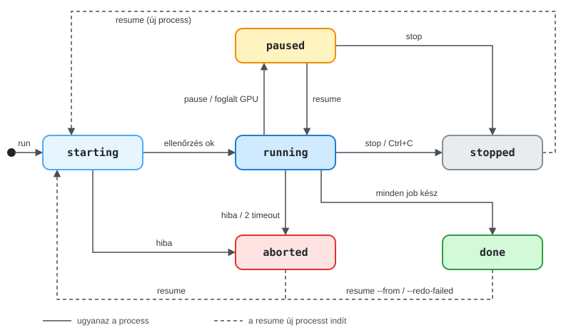

# Architektúra

[English](architecture.md)

Utolsó frissítés: 2026-11-26. **Állapot: vázlat** (a véglegesítés a roadmap D lépése). A "Jelenlegi" részek a meglévő
kódot írják le, a "Cél" és "Tervezett" részek még nincsenek megvalósítva. A feladatlista: `docs/roadmap.hu.md`.

## 1. Alapelvek

- **CLI-paritás:** a webes és bármely más grafikus felület nem tudhat többet a CLI-nél. Új funkció először a core-ban
  és a CLI-ben jelenik meg.
- **Vékony felület:** mérés, állapotkezelés, értékelés és számítás (pl. Pareto-front, pontszám) a core-ban van.
- **Kevés függőség:** a core csak a Python standard könyvtárát használja; külső csomag a felületekhez, az exporthoz és
  a TypeScript harnesshez (hivatalos LM Studio SDK) kerülhet be.
- **Biztonságos futás:** minden külső lépésnek időkorlátja van; a hibás lépést nem próbálja újra magától; foglalt GPU
  esetén szünet, időszakos újraellenőrzéssel; csak a futás által betöltött modell kerül eltávolításra; a LM Studio
  beállításfájljai nem módosulnak.
- **Helyi:** a webes szerver csak `127.0.0.1`-en figyel.
- **Kétnyelvűség (tervezett):** az angol az elsődleges, a magyar teljes értékű második nyelv. A felületek szövegei
  nyelvi fájlokból jönnek (nincs beégetett szöveg), a nyelv váltható. A kód, a kommentek, az azonosítók és az
  adatformátumok mezőnevei angolok, és nem fordulnak.

## 2. Jelenlegi felépítés

| Fájl | Szerep |
|---|---|
| `bench.cmd` | Rövid parancs a sweep futtatóhoz |
| `runner/sweep.py` | CLI, futtató, állapot- és vezérléskezelés, riport (egy fájlban) |
| `runner/smoke.py` | Smoke teszt és közös segédfüggvények (parancsfuttatás, HTTP, streamelt mérés, VRAM-mintavétel) |
| `runner/evaluate.py` | A sweep eredményeinek kiértékelése: becsült válaszidő, figyelmeztetések, ajánlások |
| `harness/load-model.ts` | Egy modellt tölt be az SDK-val, majd kilép; a futtató hívja |
| `harness/load-config.ts` | A sweep beállításainak leképezése az SDK load configra, az alkalmazott értékek ellenőrzésével |
| `configs/*.json` | Mérési rácsok: modellista, alapértékek, konfigurációk |
| `harness/sdk-probe.ts` | A hivatalos SDK próbája: alkalmazott beállítások, VRAM és sebesség |
| `harness/sdk-persist.ts` | Próba: a modell a betöltő process kilépése után is betöltve marad |
| `tools/export_docs.py` | A `docs` Markdown fájljainak (angol és magyar) PDF-exportja |
| `tests/` | Offline tesztek és egy GPU-t használó élő vezérlési teszt |

## 3. Cél felépítés (tervezett)

```
bench/
  core/   környezet, LM Studio kliens, config-tár, tervező, futtató, eredménytár, értékelés
  cli/    parancsok; minden funkció itt elérhető
  api/    FastAPI, a core vékony burkolata
harness/  TypeScript: agent tool loop, sandbox, toolok, trace log
web/      React + Vite + TypeScript, Mantine, ECharts
```

Az agent harness feladatokat futtat egy betöltött modellen és trace-t ír; a core-ban lévő hibaelemzés a trace-ekből
kategóriákat és riportot készít. A core-hoz kapcsolódó interfészét (processhatár és trace-formátum) a roadmap G lépése
előtt kell meghatározni. Követelmények: `docs/requirements.hu.md`, 3. pont.

```
core  ->  CLI
core  ->  FastAPI  ->  React
core  ->  NiceGUI (alacsony prioritás)
```

## 4. Fájlalapú interfészek (jelenlegi)

A futtató és a vezérlő parancsok külön folyamatok, fájlokon át kommunikálnak.

| Fájl | Tartalom |
|---|---|
| `state/status.json` | `run`, `state`, `phase`, `phase_since`, `reason`, `total`, `started`, `job_started`, `current` (`n`, `model`, `config`), `heartbeat`, `pid`, `pid_created` |
| `state/control.json` | `cmd` (`run` / `pause` / `stop`), `now`, `ts` |
| `state/latest.txt` | A legutóbbi futás azonosítója |
| `state/runs/<run>/plan.json` | `grid`, `jobs` (`n`, `id`, `model`, `config`, `settings`), `options`, `env` (runtime, driver, loader) |
| `results/sweep_<run>.jsonl` | Soronként egy feladat eredménye; azonos `job_id` esetén az utolsó sor érvényes |
| `report/sweep_<run>.md` | Táblázatos riport |

Eredménysor mezői sikeres feladatnál: `job_id`, `run`, `model`, `config`, `settings`, `model_path`, `runtime`,
`driver`, `loader`, `status`, `load_s`, `applied`, `loaded_path`, `vram_before_mib`, `vram_delta_mib`,
`runs`, `ttft_s`, `decode_tok_s`, `prompt_tok_s`, `vram_peak_mib`, `near_vram_limit`, `job_s`, `finished`.
Hibás sorban `error` szerepel, és a mérési mezők hiányozhatnak. A `status` értéke `ok`, `fail`, `timeout` vagy
`invalidated`.

## 5. Futási állapotok (jelenlegi)



| Állapot | Jelentés | Innen merre |
|---|---|---|
| `starting` | Előkészítés | `running`, `aborted` |
| `running` | Mérés folyik | `paused`, `stopped`, `done`, `aborted` |
| `paused` | Modell eltávolítva | `running` (`resume` parancsra, vagy foglalt GPU után magától), `stopped` |
| `stopped` | A felhasználó leállította | `resume` új folyamatot indít |
| `done` | Minden feladat lefutott | `resume --from` / `--redo-failed` új folyamatot indít |
| `aborted` | Hiba vagy két egymást követő timeout | `resume` új folyamatot indít |

A futtató akkor számít élőnek, ha a `heartbeat` 20 másodpercnél frissebb, vagy ha még létezik az a process, amelyik
írta (azonos `pid` és `pid_created`, így egy újra kiosztott PID nem számít). Egy élő process késő heartbeatje csak
figyelmeztetésként jelenik meg. Egyszerre egy futás lehet aktív. Ha a process végállapot nélkül hal meg (kill,
újraindítás), ezt a `status` mutatja, és a `resume` új processt indít, amely először eltávolítja a megszakadt futás
után bent maradt modellt. A `status --watch` két egymást követő, aktív futás nélküli olvasás után lép ki. A gráfot a
`tools/make_diagrams.py` generálja.

## 6. Parancsok és tervezett API

Az API-útvonalak javaslatok, még nincsenek megvalósítva.

| CLI (jelenlegi) | API (tervezett) |
|---|---|
| `bench run --dry-run` | `POST /plans` |
| `bench run` | `POST /runs` |
| `bench status`, `status --jobs` | `GET /runs/current`, `GET /runs/{id}/jobs` |
| `bench pause [--now]` | `POST /runs/current/pause` |
| `bench resume [--from N] [--redo-failed]` | `POST /runs/{id}/resume` |
| `bench stop [--now]` | `POST /runs/current/stop` |
| `bench evaluate [--run] [--in-tokens] [--out-tokens]` | `GET /runs/{id}/evaluation` |

## 7. Külső függések

| Függés | Mire |
|---|---|
| `lms.exe` | modellista, runtime-lista, szerver indítása és leállítása, modell eltávolítása |
| `@lmstudio/sdk` (Node) | load explicit paraméterekkel (`harness/load-model.ts`) |
| REST `POST /v1/chat/completions` | generálás és mérés |
| `nvidia-smi` | VRAM, GPU-kihasználtság, driver |
| A LM Studio `http-server.json` fájlja (belső) | API-port az SDK-hoz; részletek: `docs/lmstudio_load_parameters.hu.md` |

## 8. Tervezett formátumváltozások

- `schema_version` minden tervben és eredménysorban.
- Hardver-ujjlenyomat: GPU neve, VRAM, LM Studio verzió, runtime, driver.
- Tesztcsomag-eredmények (minőség, tool-használat) a sebességmérés mellett.
- Jelző, hogy mérés közben nyitva volt-e a dashboard.
- Modellregiszter képességcímkékkel.

## 9. Nyitott kérdések

- Az SDK API-portjának megtalálása belső LM Studio fájl nélkül.
- A megosztott GPU-memóriába csordulás felismerése.
- Tesztrétegek véglegesítése (pytest, Vitest, Playwright).
- A gépfüggő beállítások konfigurációs fájljának helye és formátuma.
