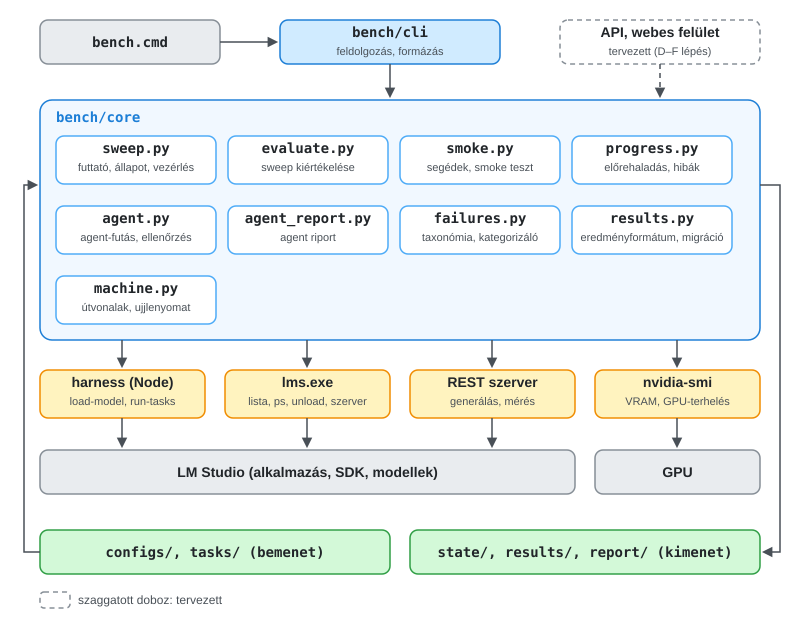
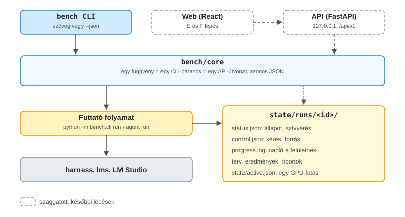

# Architektúra

[English](architecture.md)

Utolsó frissítés: 2026-11-27. **Állapot:** a vezérlő interfész és az adatformátumok a roadmap D lépésében elfogadva
(10. pont); a többi "Jelenlegi" rész a meglévő
kódot írják le, a "Cél" és "Tervezett" részek még nincsenek megvalósítva. A feladatlista: `docs/roadmap.hu.md`.

## 1. Alapelvek

- **CLI-paritás:** a webes és bármely más grafikus felület nem tudhat többet a CLI-nél. Új funkció először a core-ban
  és a CLI-ben jelenik meg.
- **Vékony felület:** mérés, állapotkezelés, értékelés és számítás (pl. Pareto-front, pontszám) a core-ban van.
- **Kevés függőség:** a Python kód csak a standard könyvtárat használja. A modelleket egy TypeScript segédprogram tölti
  be, ezért a sweephez Node.js és a hivatalos LM Studio SDK is kell. További külső csomag a felületekhez, az exporthoz
  és a harnesshez kerülhet be.
- **Biztonságos futás:** minden külső lépésnek időkorlátja van; a hibás lépést nem próbálja újra magától; foglalt GPU
  esetén szünet, időszakos újraellenőrzéssel; csak a futás által betöltött modell kerül eltávolításra; a LM Studio
  beállításfájljai nem módosulnak.
- **Helyi:** a (tervezett) webes szerver csak `127.0.0.1`-en figyel.
- **Kétnyelvűség (tervezett):** az angol az elsődleges, a magyar teljes értékű második nyelv. A felületek szövegei
  nyelvi fájlokból jönnek (nincs beégetett szöveg), a nyelv váltható. A kód, a kommentek, az azonosítók és az
  adatformátumok mezőnevei angolok, és nem fordulnak.

## 2. Jelenlegi felépítés



Az ábrát a `tools/make_diagrams.py` generálja, és minden modul-, belépésipont- vagy külsőprocess-változáskor
frissül.

| Fájl | Szerep |
|---|---|
| `bench.cmd` | Rövid parancs: a projektmappát a Python útvonalára teszi, és a `python -m bench.cli` parancsot futtatja |
| `bench/cli/main.py` | A `bench` parancssor: csak argumentumfeldolgozás és kimenetformázás; minden eredmény egy core függvényből jön (a `bench/cli/__main__.py` indítja) |
| `bench/core/progress.py` | A hosszú műveletek előrehaladás-kimenete (a CLI kiírja a sorokat, egy API összegyűjtheti őket) és a `CoreError` a core által elutasított kérésekhez |
| `bench/core/results.py` | Eredményformátum: minden sor közös borítéka, a régebbi sorok átalakítása olvasáskor, az újabb formátumok elutasítása |
| `bench/core/machine.py` | Gépfüggő útvonalak (`configs/machine.local.json`, minta: `configs/machine.example.json`) és az eredménysorok környezet-ujjlenyomata |
| `bench/core/models.py` | Modellregiszter: az `lms ls` pillanatképe a `state/models.json` fájlban (az előző a `state/models.previous.json`-ban), saját címkék a `configs/models.local.json`-ból, új modellek, képesség szerinti kiválasztás (`--where`) |
| `bench/core/sweep.py` | Adatot visszaadó sweep-műveletek (`plan_run`, `start_run`, `resume_run`, `run_status`, `request_control`, `evaluate_run`), futtató, állapot- és vezérléskezelés, táblázatos riport |
| `bench/core/evaluate.py` | A sweep eredményeinek kiértékelése: becsült válaszidő, figyelmeztetések, ajánlások |
| `bench/core/smoke.py` | A futtató által használt közös segédfüggvények (parancsfuttatás, HTTP, streamelt mérés, VRAM-mintavétel) és egy önálló smoke teszt |
| `harness/load-model.ts` | Egy modellt tölt be az SDK-val, majd kilép; a futtató hívja |
| `harness/load-config.ts` | A sweep beállításainak leképezése az SDK load configra, az alkalmazott értékek ellenőrzésével |
| `harness/load-config.test.ts` | A leképezés offline tesztje |
| `harness/sdk-probe.ts` | A hivatalos SDK próbája: alkalmazott beállítások, VRAM és sebesség |
| `harness/sdk-persist.ts` | Próba: a modell a betöltő process kilépése után is betöltve marad |
| `harness/spec-probe.ts` | Speculative decoding próba (24. feladat, 0. fázis): load draft modellel és MTP-vel, visszaolvasás, draft számlálók, REST-mezők, beragadás; a terv mintája a `configs/spec-probe.example.json` (saját példány: `spec-probe.local.json`) |
| `harness/tools-probe.ts` | Az egykörös tool-hívás próbája `respond()` és `rawTools` használatával: callbackek, a tool eredményének visszaküldése, tool nélküli eset, megszakítás |
| `harness/spec-probe-lib.ts`, `harness/spec-probe-lib.test.ts` | A próba tiszta részei (tervellenőrzés, módonkénti load config, draft arányok) és offline tesztjük |
| `bench/core/agent.py` | Adatot visszaadó agent-műveletek (`run_tasks`, `report`, `show_attempt`): betölt egy modellt, elindítja a harnesst, továbbítja a leállítást, és minden próbálkozást a trace-e alapján, a feladat ellenőrzéseivel ítél meg |
| `bench/core/failures.py` | Hibataxonómia (az egyetlen gépileg olvasható forrás) és az agent-próbálkozások szabályalapú kategorizálója; tiszta függvények |
| `bench/core/agent_report.py` | Az agent-futások riportja: a trace-ekből újraszámolja az eredményt és a kategóriákat, modellenként és feladatonként összesít (Wilson-intervallum, pass^k, lánchosszak, csendes arány), Markdownt és JSON-t ír |
| `configs/sampling.json` | Modellcsaládonkénti mintavételi profilok az agent-futásokhoz, forrással |
| `harness/run-tasks.ts` | Az agent harness belépési pontja: spec a stdinen, tool loop feladat-próbálkozásonként, `RESULT:` összegzés |
| `harness/agent/` | A harness moduljai: spec, modell-backendek (SDK-s és scriptelt), tool loop, toolok, sandbox, trace; offline tesztek az `agent.test.ts`-ben |
| `tasks/examples.json`, `tasks/fixtures/` | Példa agent-feladatok (v2 formátum: deklaratív mock toolok, várt hívások, ellenőrzések), és a sandboxukba másolt fájlok |
| `tasks/m1.json` | Az M1 feladatkészlet: 20 feladat nyolc csoportban; referenciamegoldások és hibás válaszok a `tests/m1_reference.json` és a `tests/m1_failures.json` fájlban |
| `tests/fixtures/traces/` | Rögzített élő trace-ek a kategorizáló regressziós mintáiként |
| `harness/package.json` | Node.js verziókövetelmény, a rögzített SDK verzió, TypeScript típusellenőrzés és teszt scriptek |
| `configs/*.json` | Mérési rácsok (4.1) |
| `tools/export_docs.py` | A dokumentumok (angol és magyar) PDF-exportja |
| `tools/make_diagrams.py` | A `docs/img/` SVG ábráinak generátora |
| `tests/` | Offline tesztek és egy GPU-t használó élő vezérlési teszt |

### Processek

```
bench run / resume  (futtató process)
  |-- lms.exe            modellista, runtime, betöltött modellek, szerver, unload
  |-- node load-model.ts loadonként egy rövid életű process, LM Studio SDK
  |-- HTTP szerver       generálás és mérés (REST, streamelve)
  |-- nvidia-smi         VRAM, GPU-kihasználtság, driver
bench status / pause / resume / stop  (külön processek, fájlokon át beszélnek a futtatóval)
bench agent run  (agent process)
  |-- node load-model.ts  betölti a modellt (identifier: bench-agent)
  |-- node run-tasks.ts   a harness: spec és leállítás a stdinen, haladás és RESULT a stdouton, próbálkozásonként egy trace
  |-- lms.exe             betöltött modellek, unload
```

### Egy job

Futás indításakor és folytatásakor (és dry runnál) a futtató figyelmeztet, ha a kiválasztott GGUF runtime-nak nincs
GPU-támogatása, miközben a jobok a GPU-ra offloadolnak.

Egy job egy modell egy konfigurációval. A futtató a jobokat egymás után hajtja végre:

1. **A gép ellenőrzése** (`checking GPU`): egy megszakadt futás után bent maradt `bench-sweep` modell eltávolítása; más
   modell nem lehet betöltve; a szabad VRAM legalább `min_free_mib`; három minta medián GPU-kihasználtsága legfeljebb
   `max_util`. Különben a futás szünetel.
2. **Szerver:** ha nem fut, elindítja a LM Studio szervert, és kiolvassa a portját.
3. **Load** (`loading model`) a segédprogrammal (4.4). A job hibás, ha más fájl töltődött be, vagy egy kért beállítás
   nem jelenik meg az alkalmazott konfigurációban.
4. A VRAM-növekedés rögzítése.
5. **Bemelegítő generálás** (`warm-up generation`), az eredménye eldobva.
6. **Mért generálások** (`measuring i/n`), `repeats` alkalommal: `prompt_lines` soros szintetikus prompt egyedi első
   sorral (prompt cache ellen), temperature 0, seed 1, legfeljebb `gen_tokens` token, streamelve. Generálás közben VRAM
   mintavétel. Az első token ideje adja a prompt-sebességet (`prompt_tokens / ttft_s`), a további tokenek a
   decode-sebességet.
7. A futás saját modelljének **eltávolítása**.
8. Az eredménysor hozzáfűzése (az ismétlések mediánja) és a táblázatos riport újraírása.

A hibás vagy időtúllépett lépés a jobot `fail` vagy `timeout` állapotba teszi, és a futás megy tovább; két egymást
követő timeout megszakítja.

## 3. Cél felépítés (tervezett)

```
bench/
  core/   környezet, LM Studio kliens, tervező, futtató, eredménytár, értékelés
  cli/    parancsok; minden funkció itt elérhető
  api/    FastAPI, a core vékony burkolata
harness/  TypeScript: modellbetöltő, agent tool loop, sandbox, toolok, trace log
web/      React + Vite + TypeScript, Mantine, ECharts
```

Az agent harness feladatokat futtat egy betöltött modellen és trace-t ír; a core-ban lévő hibaelemzés a trace-ekből
kategóriákat és riportot készít. A core felé az interfész 2026-11-26-án eldőlt, és még aznap megvalósult M1-re
(`docs/requirements.hu.md`, 3. pont, H1–H7):

```
core --stdin: load spec--------> node load-model.ts  --> LM Studio (SDK)
core --stdin: task spec, stop--> node run-tasks.ts   --> LM Studio (SDK, predikciónként egy kör)
     <--stdout: RESULT: összegzés--    |--> sandbox mappa feladatonként (read_file, mock_lookup)
                                       |--> trace JSONL feladat-futásonként
core: pass/fail ellenőrzés és hibakategóriák a trace-ekből és a sandbox végállapotából
```

```
core  ->  CLI
core  ->  FastAPI  ->  React
core  ->  NiceGUI (alacsony prioritás)
```

## 4. Adatformátumok és interfészek (jelenlegi)

### 4.1 Rácsfájl (a futás bemenete)

| Kulcs | Tartalom |
|---|---|
| `comment` | Szabad szöveg |
| `models` | Modellkulcsok listája az `lms ls` szerint; a `--models` felülírja |
| `defaults` | Minden jobra érvényes load beállítások (lenti tábla) |
| `configs` | Konfigurációk listája: `id`, opcionális `only_params` (modellméretek, pl. `"12B"`, az `lms ls` által közölt mérettel összevetve), és bármely, az alapértéket felülíró beállítás |

| Beállítás | Jelentés |
|---|---|
| `context_length` | Contexthossz tokenben |
| `offload_ratio` | GPU-offload, 0 (csak CPU) és 1 (minden a GPU-n) között |
| `flash_attention` | true / false |
| `eval_batch_size`, `physical_batch_size` | Batch méretek |
| `parallel` | Párhuzamos predikciók maximuma |
| `offload_kv_cache_to_gpu` | true / false |
| `unified_kv` | Unified KV cache, true / false |
| `threads` | CPU-szálak |
| `kv_quant` | `null` (f16) vagy `"q8_0"` a K és a V cache-re egyaránt |

A speculative decoding még nem rácsbeállítás: a loader minden loadnál explicit kikapcsolja.

A jobok modellenként, a `configs` sorrendjében jönnek létre; a job azonosítója `<modell>|<config id>`, a számozás 1-től
indul. A `configs/*.local.json` fájlok a felhasználó saját, nem követett rácsai; a `bench run` a
`configs/quick.local.json` fájlt használja, ha létezik, különben a `configs/quick.json` fájlt.

### 4.2 Fájlok a processek között

| Fájl | Tartalom |
|---|---|
| `state/status.json` | `run`, `state`, `phase`, `phase_since`, `reason`, `total`, `started`, `job_started`, `current` (`n`, `model`, `config`), `heartbeat` (2 s-onként íródik), `pid`, `pid_created`, `warning` |
| `state/control.json` | `cmd` (`run` / `pause` / `stop`), `now`, `ts` |
| `state/latest.txt` | A legutóbbi futás azonosítója (az indulás ideje, `YYYYMMDD_HHMMSS`) |
| `state/runs/<run>/plan.json` | `grid`, `jobs` (`n`, `id`, `model`, `config`, `settings`), `options`, `env` (`runtime`, `driver`, `loader`) |
| `results/sweep_<run>.jsonl` | Soronként egy job eredménye; azonos `job_id` esetén az utolsó sor érvényes |
| `report/sweep_<run>.md` | Táblázatos riport |
| `report/eval_<run>.md` | Kiértékelő riport (4.5) |

Az `options` a futás parancssori beállításait tárolja: `repeats`, `gen_tokens`, `prompt_lines`, `load_timeout`,
`gen_timeout`, `min_free_mib`, `max_util`, `busy_retry_s`, folytatás után pedig `allow_env_change`. A futás ezekkel az
értékekkel folytatódik; ha az `env` eltér a gép mostani állapotától, `--allow-env-change` nélkül leáll.

### 4.3 Eredménysorok

A C3 lépés óta minden sor a `schema_version` (az eredményformátum, most 1; független a feladatfájl verziójától, amelyet az agent-sorok `tasks_schema_version` néven őriznek), a `kind` (`sweep` vagy `agent`) és a `run` mezővel kezdődik, és az `env` mezővel zárul: `gpu`, `vram_total_mib`, `driver`, `lmstudio_app`, `runtime`, `sdk`, `harness`, `os`, `python`, `node` (a ki nem olvasható érték `null`). A korábban írt soroknak nincs `kind` mezője; a core olvasáskor alakítja át őket (`migrated_from: 0`), a fájlt soha nem írja át. Újabb formátumú sornál az olvasás a fájl nevével és a verzióval leáll. Kód: `bench/core/results.py`.

Sikeres sor mezői: `job_id`, `run`, `model`, `config`, `settings`, `model_path`, `runtime`, `driver`, `loader`,
`status`, `load_s`, `applied`, `loaded_path`, `app_version` (a loadot kiszolgáló alkalmazás), `vram_before_mib`, `vram_delta_mib`, `runs`, `ttft_s`, `decode_tok_s`,
`prompt_tok_s`, `vram_peak_mib`, `near_vram_limit` (a csúcs 250 MiB-on belül a teljes mérethez), `job_s`, `finished`. A
`runs` minden eleme: `ttft_s`, `decode_tok_s`, `prompt_tok_s`, `prompt_tokens` és `vram_peak_mib`.

A `status` értéke `ok`, `fail`, `timeout` vagy `invalidated`. A hibás sorban `error` van, és a mérési mezők
hiányozhatnak; ha a gép nem volt használható, csak `job_id`, `run`, `model`, `config`, `status` és `error` szerepel. A
`resume --from` csak `job_id` és `invalidated` tartalmú sorokat fűz hozzá.

### 4.4 Loader segédprogram

A futtató minden jobhoz a `node load-model.ts` parancsot indítja a `harness/` mappában.

- **Bemenet** (JSON a standard inputon): `model` (a fájl útvonala az `lms ls` szerint), `identifier`, `settings`,
  `timeoutMs`.
- **Siker:** az utolsó kimeneti sor `RESULT:`, utána JSON: `path`, `identifier`, `loadSeconds`, `applied` (a LM
  Studióból visszaolvasott konfiguráció), `mismatches` és `app` (a kiszolgáló alkalmazás verziója).
- **Hiba:** nem nulla kilépési kód, az üzenet a standard erroron. Semmit nem próbál újra.
- Az SDK API-portját egy belső LM Studio fájlból olvassa; az útvonalát az `LMS_API_FILE` környezeti változó felülírja. A
  modell a segédprogram kilépése után is betöltve marad. Részletek: `docs/lmstudio_load_parameters.hu.md`.

### 4.5 Kiértékelés

A `bench evaluate` egy eredményfájlt olvas, offline. Rangsorolási metrika: egy kérés becsült ideje másodpercben,
`in_tokens / prompt_tok_s + out_tokens / decode_tok_s` (alapból 2000 és 500). Modellenként és contexthosszanként a
leggyorsabb konfigurációt ajánlja, és ha a győztesen jelző van, megnevezi a leggyorsabb jelző nélkülit is. A jelzők
heurisztikák: `spill?` (a prompt-sebesség a modell legjobbjának fele alatt, vagy teljes offloadnál a decode a legjobb
60%-a alatt) és `unstable` (az ismétlések decode-ban 10%-nál, prompt-sebességben 25%-nál jobban eltérnek). A riport
figyelmeztet, ha a loadok előtti VRAM-foglalás 500 MiB-nál többet ingadozott.

## 5. Futási állapotok (jelenlegi)


| Állapot | Jelentés | Innen merre |
|---|---|---|
| `starting` | Előkészítés | `running`, `stopped`, `aborted` |
| `running` | Mérés folyik | `paused`, `stopped`, `done`, `aborted` |
| `paused` | Modell eltávolítva, a futás által indított szerver leállítva | `running` (`resume` parancsra, vagy foglalt GPU után magától), `stopped` |
| `stopped` | A felhasználó leállította (`stop` vagy Ctrl+C) | `resume` új processt indít |
| `done` | Minden job lefutott | `resume --from` / `--redo-failed` új processt indít |
| `aborted` | Hiba vagy két egymást követő timeout | `resume` új processt indít |

- **Pause és stop** az aktuális job után hat; `--now` esetén a következő ellenőrzési ponton, és a félbehagyott job
  újramérésre kerül. A folyamatban lévő modellbetöltést megvárja.
- **Automatikus szünet** (a gép nem áll készen) `busy_retry_s` másodpercenként újraellenőriz, és magától folytatódik; a
  `pause` parancs kikapcsolja az újraellenőrzést.
- **Élő futtató:** akkor számít élőnek, ha a `heartbeat` 20 másodpercnél frissebb, vagy ha még létezik az a process,
  amelyik írta (azonos `pid` és `pid_created`, így egy újra kiosztott PID nem számít). Egy élő process késő heartbeatje
  csak figyelmeztetésként jelenik meg. Egyszerre egy futás lehet aktív.
- **Meghalt process:** ha végállapot nélkül ér véget (kill, újraindítás), ezt a `status` mutatja, és a `resume` új
  processt indít, amely először eltávolítja a megszakadt futás után bent maradt modellt.
- A `status --watch` két egymást követő, aktív futás nélküli olvasás után lép ki.

A gráfot a `tools/make_diagrams.py` generálja.

## 6. Parancsok és tervezett API

Az API-útvonalak javaslatok, még nincsenek megvalósítva.

| CLI (jelenlegi) | API (tervezett) |
|---|---|
| `bench run --dry-run` | `POST /plans` |
| `bench run [--grid] [--models] [--where] [--repeats] [--gen-tokens] [--prompt-lines] [--load-timeout] [--gen-timeout] [--min-free-mib] [--max-util] [--busy-retry]` | `POST /runs` |
| `bench status [--watch] [--jobs]` | `GET /runs/current`, `GET /runs/{id}/jobs` |
| `bench pause [--now]` | `POST /runs/current/pause` |
| `bench resume [--run] [--from N] [--redo-failed] [--allow-env-change]` | `POST /runs/{id}/resume` |
| `bench stop [--now]` | `POST /runs/current/stop` |
| `bench evaluate [--run] [--in-tokens] [--out-tokens]` | `GET /runs/{id}/evaluation` |
| `bench agent run [--model \| --models] [--where] [--tasks] [--only] [--repeats] [--context] [--temperature] [--scripted]` | `POST /agent-runs` |
| `bench agent report [--run ...] [--k] [--reliable]` | `GET /agent-runs/{id}/report` |
| `bench agent show <run> <task-attempt> [--model]` | `GET /agent-runs/{id}/attempts/{task-attempt}` |
| `bench models refresh` / `list [--where]` / `new` | `POST /models/snapshot`, `GET /models`, `GET /models/new` |

A `run` és a `resume` kilépési kódja: 0, ha a futás lefutott vagy a felhasználó állította le, 3, ha megszakadt, 2
használhatatlan argumentumoknál. Az alapértékeket a `bench <parancs> --help` listázza.

Egyéb belépési pontok: `python bench/core/smoke.py` (egy modell smoke tesztje: leltár, GPU-ellenőrzés, load a CLI-vel,
generálás, tool-hívás próba; a `results/smoke_*.json` fájlt és egy modellistát ír az `inventory/` mappába),
`python tools/export_docs.py`, `python tools/make_diagrams.py` és a `harness/` próbái.

## 7. Külső függések

| Függés | Mire |
|---|---|
| Python (3.15.2-vel tesztelve) | futtató, kiértékelés, segédeszközök, tesztek |
| Node.js 24 vagy újabb | loader segédprogram és a harness próbái |
| `@lmstudio/sdk` | load explicit paraméterekkel (`harness/load-model.ts`) |
| LM Studio alkalmazás | futnia kell |
| `lms.exe` | modellista (`ls`), runtime-lista, betöltött modellek (`ps`), szerver indítása és leállítása, unload; load csak a smoke tesztben |
| REST `POST /v1/chat/completions` | generálás és mérés |
| `nvidia-smi` | VRAM, GPU-kihasználtság, driver |
| A LM Studio `http-server.json` fájlja (belső) | API-port az SDK-hoz; részletek: `docs/lmstudio_load_parameters.hu.md` |
| Microsoft Edge | csak a dokumentumok PDF-exportja |

A futtató Windows-specifikus (`lms.exe` útvonala, process-ellenőrzés).

## 8. Tervezett formátumváltozások

Az első két pont a C lépésben tervezett ([követelmények](requirements.hu.md), 7. pont).

- `schema_version` minden tervben (az eredménysorokban a C3 lépés óta megvan).
- A modellenként ténylegesen használt runtime (a C3 lépés ujjlenyomata a kiválasztott runtime-ot rögzíti).
- Tesztcsomag-eredmények (minőség, tool-használat) a sebességmérés mellett.
- Jelző, hogy mérés közben nyitva volt-e a dashboard.
- Speculative decoding (24. feladat): rácsbeállítások, draft statisztikák, terhelésprofil és backend mező.

## 9. Nyitott kérdések

- Az SDK API-portjának megtalálása belső LM Studio fájl nélkül.
- A megosztott GPU-memóriába csordulás felismerése.
- Tesztrétegek véglegesítése (pytest, Vitest, Playwright).
- Kell-e második inferencia-backend (`llama-server`) a további speculative decoding módszerekhez.
- Gépfüggő beállítások: a Python-kódban a C3 lépésben kész (`configs/machine.local.json`, CR-15); a `harness/` próbái
  még maguk állítják elő a LM Studio útvonalait.

## 10. Vezérlő interfész (elfogadva 2026-11-27, D lépés)



A parancssor és az API ugyanazokat a core függvényeket hívja; egy core függvény egy CLI-parancs és egy API-útvonal, a
`--json` pontosan azt írja ki, amit az API visszaad. Követelmények: [követelmények](requirements.hu.md), 8. pont
(IF-01–IF-23). Megvalósítás a roadmap D2 lépésében, a webes munka előtt.

| # | Téma | Döntés | Indok |
|---|---|---|---|
| 1 | Hosszú futások indítása az API-ból | A parancssor külön folyamataként (`python -m bench.cli run …`, `… agent run …`) | A futás túléli a böngésző vagy az API újraindítását; a szünet, a leállítás és a folytatás már fájlokon át működik |
| 2 | Kimenet a felületeknek | `--json` minden eredményt adó parancson; az API ugyanezt az adatot adja | Egy adatforrás; a CLI-paritás tesztelhető |
| 3 | Egy futás állapota | Futásonként `state/runs/<id>/` a `status.json`, `control.json`, `progress.log` fájlokkal, sweep- és agent-futásnál is; a `state/status.json` csak az aktív futásra mutat | Egy új futás már nem írja felül a régebbi állapotát; az agent-futás is kap állapotot |
| 4 | Több futás egyszerre | Egyszerre egy GPU-futás, a `state/active.json` fájlon át, sweep- és agent-futás között is | A párhuzamos terhelés elrontja a mérést |
| 5 | Élő napló | Futásonként `progress.log`; az API olvassa, később folyamatos stream is jöhet | A core előrehaladás-kimenetének csak egy fájl kell |
| 6 | CLI- és webes vezérlés egyszerre | Az utolsó kérés nyer; a `control.json` rögzíti a forrását (`cli`, `web`) és idejét, és az állapot mutatja | Egyszerű, és látszik, ki kérte |
| 7 | Agent-futás leállítása | A vezérlőfájlon át is, a stdin-leállítás mellett; szünet nincs, egy próbálkozás nem darabolható | A felület le tudja állítani az agent-futást |
| 8 | Az API stílusa | REST és JSON a `/api/v1` alatt, csak `127.0.0.1` címen | Korábbi döntések: FastAPI, helyi használat |

**Adatformátumok és verzióik** (2026-11-27-i állapot):

| Formátum | Hol | Verzió | Megjegyzés |
|---|---|---|---|
| Eredménysor | `results/*.jsonl` | `schema_version` 1 | Boríték `kind` és `env` mezővel; a régebbi sorok olvasáskor átalakulnak (4.3 pont) |
| Agent-trace | `results/agent/<run>/…/traces/*.jsonl` | 2 (harness) | Soronként egy esemény |
| Feladatfájl | `tasks/*.json` | 2 | A követelmények 3. pontja szerinti formátum |
| Harness futásleíró | a `run-tasks.ts` stdin-je | 2 | A core-tól a harnessnek |
| Mintavételi profilok | `configs/sampling.json` | 1 | |
| Modellregiszter-pillanatkép | `state/models.json` | 1 | |
| Agent-riport | `report/agent_<run>.json` | nincs, `taxonomy_version` 2 | Az IF-23 szerint verziót kap, ha a felület olvassa |
| Rácsfájl | `configs/*.json` | nincs | Felhasználói bemenet; a formátum a 4.1 pont |
| Futásterv, futásállapot, vezérlés | `state/` | nincs | A D2 lépésben kap verziót (IF-23) |
