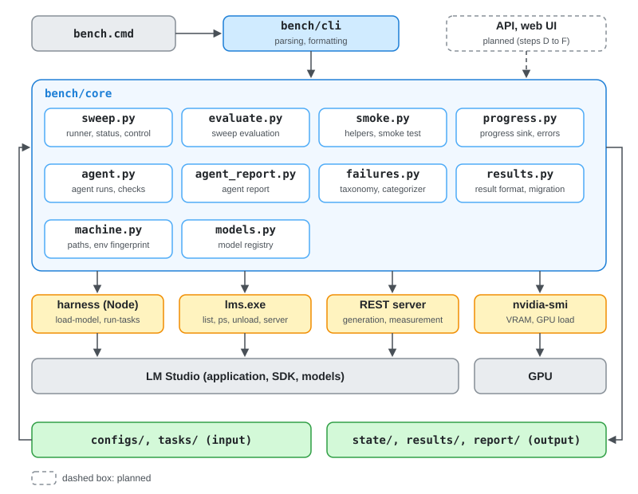
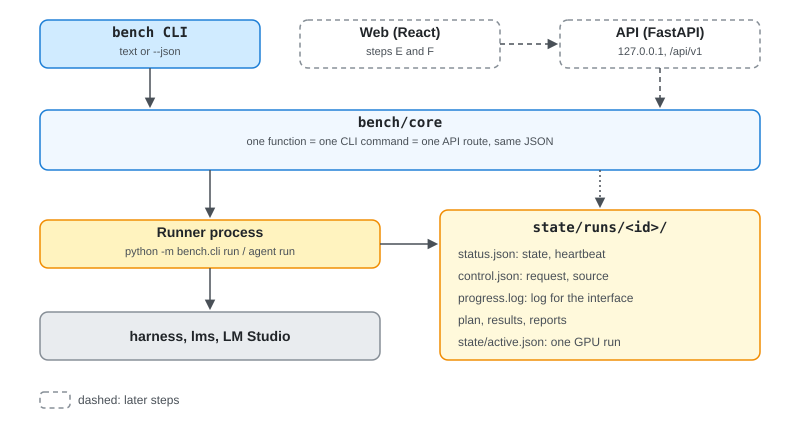

# Architecture

[Magyar](architecture.hu.md)

Last updated: 2026-11-27. **Status:** the control interface and the data formats were agreed in roadmap step D
(section 10); the other "current" parts describe the
existing code; the "target" and "planned" parts are not implemented yet. Task list: `docs/roadmap.md`.

## 1. Principles

- **CLI parity:** the web UI and any other graphical interface cannot do more than the CLI. New features appear in the
  core and CLI first.
- **Thin interfaces:** measurement, state handling, evaluation and computation (e.g. Pareto front, scores) live in the core.
- **Few dependencies:** the Python code uses only the standard library. Models are loaded through a TypeScript helper, so
  a sweep also needs Node.js and the official LM Studio SDK. Further external packages are allowed for interfaces,
  exports and the harness.
- **Safe runs:** every external step has a timeout; failed steps are not retried automatically; pause when the GPU is
  busy, with periodic re-checks; only the model loaded by the run is unloaded; LM Studio's settings files are not
  modified.
- **Local:** the web server (planned) listens on `127.0.0.1` only.
- **Bilingual (planned):** English is primary, Hungarian is a full second language. UI texts come from language files
  (no hard-coded strings) and the language is switchable. Code, comments, identifiers and data field names are English
  and are not translated.

## 2. Current structure



The diagram is generated by `tools/make_diagrams.py` and is updated whenever modules, entry points or external
processes change.

| File | Role |
|---|---|
| `bench.cmd` | Short command: puts the project folder on the Python path and runs `python -m bench.cli` |
| `bench/cli/main.py` | The `bench` command line: argument parsing and output formatting only; every result comes from a core function (`bench/cli/__main__.py` starts it) |
| `bench/core/progress.py` | Progress sink of long-running operations (the CLI prints the lines, an API can collect them) and `CoreError` for requests the core refuses |
| `bench/core/results.py` | Result format: the common envelope of every row, reading with conversion of older rows, refusal of newer formats |
| `bench/core/machine.py` | Machine-specific paths (`configs/machine.local.json`, example in `configs/machine.example.json`) and the environment fingerprint of result rows |
| `bench/core/models.py` | Model registry in `state/models.json`: the installed models with the date each was first seen, the models that are gone, own tags from `configs/models.local.json`, the new mark, selection by capability (`--where`, refreshed before a run) |
| `bench/core/runstate.py` | Per-run state files (`state/runs/<id>/`: status, control, progress log) and the lock `state/active.json` that allows one GPU run at a time, for sweep and agent runs |
| `bench/core/sweep.py` | Sweep operations that return data (`plan_run`, `start_run`, `resume_run`, `run_status`, `request_control`, `evaluate_run`), runner, pause and resume handling, table report |
| `bench/core/evaluate.py` | Evaluation of sweep results: estimated response time, warnings, recommendations |
| `bench/core/smoke.py` | Shared helpers used by the runner (commands, HTTP, streamed measurement, VRAM sampling) and a stand-alone smoke test |
| `harness/load-model.ts` | Loads one model through the SDK and exits; called by the runner |
| `harness/load-config.ts` | Mapping of sweep settings to the SDK load config, with a check of the applied values |
| `harness/load-config.test.ts` | Offline test of that mapping |
| `harness/sdk-probe.ts` | Probe of the official SDK: applied settings, VRAM and speed |
| `harness/sdk-persist.ts` | Probe: a model stays loaded after the loading process exits |
| `harness/spec-probe.ts` | Speculative decoding probe (task 24, phase 0): draft model and MTP loads, read-back, draft counters, REST fields, persistence; plan from `configs/spec-probe.example.json` (own copy: `spec-probe.local.json`) |
| `harness/tools-probe.ts` | Probe of single-round tool calls with `respond()` and `rawTools`: callbacks, tool result round trip, no-tool case, abort |
| `harness/spec-probe-lib.ts`, `harness/spec-probe-lib.test.ts` | Pure parts of the probe (plan check, load configs per mode, draft ratios) and their offline test |
| `bench/core/agent.py` | Agent operations that return data (`run_tasks`, `report`, `show_attempt`): loads one model, starts the harness, passes a stop on, judges each attempt from its trace with the task's checks |
| `bench/core/failures.py` | Failure taxonomy (single machine-readable source) and the rule-based categorizer of agent attempts; pure functions |
| `bench/core/agent_report.py` | Report of agent runs: recomputes verdicts and categories from the traces, aggregates per model and task (Wilson intervals, pass^k, chain lengths, silent share), writes Markdown and JSON |
| `configs/sampling.json` | Sampling profiles per model family for agent runs, with sources |
| `harness/run-tasks.ts` | Agent harness entry point: spec on stdin, tool loop per task attempt, `RESULT:` summary |
| `harness/agent/` | Harness modules: spec, model backends (SDK and scripted), tool loop, tools, sandbox, trace; offline tests in `agent.test.ts` |
| `tasks/examples.json`, `tasks/fixtures/` | Example agent tasks (format v2: declarative mock tools, expected calls, checks), and the files copied into their sandboxes |
| `tasks/m1.json` | The M1 task set: 20 tasks in eight groups; reference solutions and failing replies in `tests/m1_reference.json` and `tests/m1_failures.json` |
| `tests/fixtures/traces/` | Recorded live traces used as regression samples for the categorizer |
| `harness/package.json` | Node.js version requirement, the pinned SDK version, TypeScript type check and test scripts |
| `configs/*.json` | Measurement grids (section 4.1) |
| `tools/export_docs.py` | PDF export of the documents (English and Hungarian) |
| `tools/make_diagrams.py` | Generator of the SVG diagrams in `docs/img/` |
| `tests/` | Offline tests and one live control test that uses the GPU |

### Processes

```
bench run / resume  (runner process)
  |-- lms.exe            model list, runtime, loaded models, server, unload
  |-- node load-model.ts one short-lived process per load, LM Studio SDK
  |-- HTTP server        generation and measurement (REST, streamed)
  |-- nvidia-smi         VRAM, GPU utilization, driver
bench status / pause / resume / stop  (separate processes, talk to the runner through the run's files)
bench agent run  (agent process; takes the same GPU lock as a sweep)
  |-- node load-model.ts  loads the model (identifier bench-agent)
  |-- node run-tasks.ts   the harness: spec and stop on stdin, progress and RESULT on stdout, one trace per attempt
  |-- lms.exe             loaded models, unload
```

### One job

At the start of a run or resume (and in a dry run) the runner warns if the selected GGUF runtime has no GPU support
while jobs offload to the GPU.

A job is one model with one configuration. The runner executes the jobs one after the other:

1. **Check the machine** (`checking GPU`): remove a `bench-sweep` model left over from a killed run; no other model may
   be loaded; free VRAM at least `min_free_mib`; median GPU utilization of three samples at most `max_util`. Otherwise
   the run pauses.
2. **Server:** start the LM Studio server if it is not running and read its port.
3. **Load** (`loading model`) through the helper (section 4.4). The job fails if another file was loaded or a requested
   setting is not reflected in the applied configuration.
4. Record the VRAM increase.
5. **Warm-up generation** (`warm-up generation`), discarded.
6. **Measured generations** (`measuring i/n`), `repeats` times: a synthetic prompt of `prompt_lines` lines with a unique
   first line (against prompt caching), temperature 0, seed 1, at most `gen_tokens` tokens, streamed. VRAM is sampled
   during generation. Time to first token gives the prompt speed (`prompt_tokens / ttft_s`), the following tokens the
   decode speed.
7. **Unload** the run's own model.
8. Append the result row (medians over the repeats) and rewrite the table report.

A failed or timed-out step marks the job `fail` or `timeout` and the run goes on; two consecutive timeouts abort it.

## 3. Target structure (planned)

```
bench/
  core/   environment, LM Studio client, planner, runner, result store, evaluation
  cli/    commands; every feature is reachable here
  api/    FastAPI, a thin wrapper around the core
harness/  TypeScript: model loader, agent tool loop, sandbox, tools, trace log
web/      React + Vite + TypeScript, Mantine, ECharts
```

The agent harness runs tasks against a loaded model and writes a trace; failure analysis in the core turns traces into
categories and reports. The interface to the core was decided on 2026-11-26 and implemented for M1 the same day
(`docs/requirements.md`, section 3, H1–H7):

```
core --stdin: load spec--------> node load-model.ts  --> LM Studio (SDK)
core --stdin: task spec, stop--> node run-tasks.ts   --> LM Studio (SDK, one round per prediction)
     <--stdout: RESULT: summary--      |--> sandbox folder per task (read_file, mock_lookup)
                                       |--> trace JSONL per task run
core: pass/fail checks and failure categories from the traces and the sandbox final state
```

```
core  ->  CLI
core  ->  FastAPI  ->  React
core  ->  NiceGUI (low priority)
```

## 4. Data formats and interfaces (current)

### 4.1 Grid file (input of a run)

| Key | Content |
|---|---|
| `comment` | Free text |
| `models` | List of model keys as printed by `lms ls`; `--models` overrides it |
| `defaults` | Load settings applied to every job (table below) |
| `configs` | List of configurations: `id`, optional `only_params` (model sizes such as `"12B"`, matched against the size reported by `lms ls`), and any setting that overrides the default |

| Setting | Meaning |
|---|---|
| `context_length` | Context length in tokens |
| `offload_ratio` | GPU offload, 0 (CPU only) to 1 (everything on the GPU) |
| `flash_attention` | true / false |
| `eval_batch_size`, `physical_batch_size` | Batch sizes |
| `parallel` | Maximum parallel predictions |
| `offload_kv_cache_to_gpu` | true / false |
| `unified_kv` | Unified KV cache, true / false |
| `threads` | CPU threads |
| `kv_quant` | `null` (f16) or `"q8_0"` for both K and V cache |

Speculative decoding is not a grid setting yet: the loader switches it off explicitly for every load.

Jobs are generated model by model in the order of `configs`; the job id is `<model>|<config id>` and jobs are numbered
from 1. `configs/*.local.json` files are the user's own grids and are not tracked; `bench run` uses
`configs/quick.local.json` if it exists, otherwise `configs/quick.json`.

### 4.2 Files between the processes

| File | Content |
|---|---|
| `state/active.json` | The run that holds the GPU: `run`, `kind` (`sweep` / `agent`), `pid`, `pid_created`, `started`; created exclusively at the start, removed at the end; a lock whose process no longer exists counts as free |
| `state/runs/<run>/status.json` | `run`, `kind`, `state`, `phase`, `phase_since`, `reason`, `total`, `started`, `job_started`, `current` (sweep: `n`, `model`, `config`; agent: `n`, `model`), `heartbeat` (written every 2 s), `pid`, `pid_created`, `warning`; agent runs also `scripted` |
| `state/runs/<run>/control.json` | The last request: `cmd` (`run` / `pause` / `stop`), `now`, `source` (`cli` / `web` from a user, `runner` from the run itself: start, automatic pause and resume), `ts`; when the runner acknowledges a user's `resume`, the source is kept |
| `state/runs/<run>/progress.log` | Every progress line of the run as the command line shows it, with the time `HH:MM:SS` (the date is in the run id), harness lines included; appended only by the run's own process |
| `state/latest.txt` | Id of the latest sweep (its start time, `YYYYMMDD_HHMMSS`) |
| `state/status.json`, `state/control.json` | Written by versions before step D2a; only read, as the status of a run that has no file of its own |
| `state/runs/<run>/plan.json` | `grid`, `jobs` (`n`, `id`, `model`, `config`, `settings`), `options`, `env` (`runtime`, `driver`, `loader`) |
| `results/sweep_<run>.jsonl` | One job result per line; the last line wins for a given `job_id` |
| `report/sweep_<run>.md` | Table report |
| `report/eval_<run>.md` | Evaluation report (section 4.5) |

`options` holds the run's command line settings: `repeats`, `gen_tokens`, `prompt_lines`, `load_timeout`,
`gen_timeout`, `min_free_mib`, `max_util`, `busy_retry_s`, and `allow_env_change` after a resume. A run continues with
these values; if `env` differs from the current machine it stops unless `--allow-env-change` is given.

Sweep and agent run ids share one name space (the start time); a run waits for the next second if the id is taken.
The files of a run stay after it ends, and a new run never writes into them (IF-10, IF-11). A scripted agent run
(`--scripted`) gets its state folder but takes no GPU lock, because it uses no GPU.

### 4.3 Result rows

Since step C3 every row starts with `schema_version` (the result format, now 1; independent of the task file version, which agent rows keep as `tasks_schema_version`), `kind` (`sweep` or `agent`) and `run`, and ends with `env`: `gpu`, `vram_total_mib`, `driver`, `lmstudio_app`, `runtime`, `sdk`, `harness`, `os`, `python`, `node` (a value that cannot be read is `null`). Rows written before have no `kind`; the core converts them when it reads them (`migrated_from: 0`) and never rewrites the file. A row of a newer format stops the reading with the file name and the version. Code: `bench/core/results.py`.

Fields of a successful row: `job_id`, `run`, `model`, `config`, `settings`, `model_path`, `runtime`, `driver`,
`loader`, `status`, `load_s`, `applied`, `loaded_path`, `app_version` (application that served the load), `vram_before_mib`, `vram_delta_mib`, `runs`, `ttft_s`,
`decode_tok_s`, `prompt_tok_s`, `vram_peak_mib`, `near_vram_limit` (peak within 250 MiB of the total), `job_s`,
`finished`. Each element of `runs` has `ttft_s`, `decode_tok_s`, `prompt_tok_s`, `prompt_tokens` and `vram_peak_mib`.

`status` is `ok`, `fail`, `timeout` or `invalidated`. A failed row has `error` and may lack the measurement fields; if
the machine was not usable it holds only `job_id`, `run`, `model`, `config`, `status` and `error`. `resume --from`
appends rows with just `job_id` and `invalidated`.

### 4.4 Loader helper

The runner starts `node load-model.ts` in `harness/` for each job.

- **Input** (JSON on standard input): `model` (file path as reported by `lms ls`), `identifier`, `settings`, `timeoutMs`.
- **Success:** the last output line is `RESULT:` followed by JSON with `path`, `identifier`, `loadSeconds`, `applied`
  (the configuration read back from LM Studio), `mismatches` and `app` (version of the serving application).
- **Failure:** non-zero exit code with the message on standard error. Nothing is retried.
- The SDK's API port is read from an internal LM Studio file; the `LMS_API_FILE` environment variable overrides its
  path. The model stays loaded after the helper exits. Details: `docs/lmstudio_load_parameters.md`.

### 4.5 Evaluation

`bench evaluate` reads a result file and works offline. Ranking metric: estimated seconds for a request,
`in_tokens / prompt_tok_s + out_tokens / decode_tok_s` (default 2000 and 500). It recommends the fastest configuration
per model and context length, and names the fastest unflagged one if the winner carries a flag. Flags are heuristics:
`spill?` (prompt speed below half of the model's best, or with full offload decode below 60 % of the best) and
`unstable` (repeats differ by more than 10 % in decode or 25 % in prompt speed). The report warns if the VRAM used
before the loads varied by more than 500 MiB.

## 5. Run states (current)


| State | Meaning | Next |
|---|---|---|
| `starting` | Preparation | `running`, `stopped`, `aborted` |
| `running` | Measuring | `paused`, `stopped`, `done`, `aborted` |
| `paused` | Model unloaded, a server started by the run stopped | `running` (on `resume`, or by itself after a busy GPU), `stopped` |
| `stopped` | Stopped by the user (`stop` or Ctrl+C) | `resume` starts a new process |
| `done` | All jobs finished | `resume --from` / `--redo-failed` starts a new process |
| `aborted` | Error or two consecutive timeouts | `resume` starts a new process |

- **Pause and stop** take effect after the current job; with `--now` at the next checkpoint, and the interrupted job is
  measured again. A model load in progress is awaited.
- **Automatic pause** (machine not ready) re-checks every `busy_retry_s` seconds and continues by itself; a `pause`
  command turns the re-checks off.
- **Alive:** the runner counts as alive while its `heartbeat` is younger than 20 seconds, or while the process that wrote
  it still exists (same `pid` and `pid_created`, so a reused PID does not count). A late heartbeat of a living process
  is only reported as a warning.
- **One GPU run:** a sweep or agent run starts only after taking the lock `state/active.json`; while another run holds
  it, the start is refused with the active run's kind and id (IF-13). `resume` of a living paused sweep only sends a
  request and needs no lock. `bench status` shows the active run (sweep or agent), otherwise the latest sweep, and the
  last request with its source (IF-14).
- **Agent stop:** `bench stop` (with or without `--now`) writes `stop` into the agent run's control file; the core reads
  it every 0.5 s and sends the harness its stop command, the same path as Ctrl+C (IF-15). The current attempt ends as
  stopped, no further model starts, and the run ends as `stopped`. A stop during a model load takes effect after the
  load: the harness is then not started. `bench pause` is refused for an agent run.
- **Dead process:** if it ends without reaching an end state (killed, reboot), `status` shows it and `resume` starts a
  new process, which first unloads a model left over from the dead run.
- `status --watch` ends after two readings in a row without an active run.

The graph is generated by `tools/make_diagrams.py`.

## 6. Commands and planned API

The API routes are proposals and not implemented.

| CLI (current) | API (planned) |
|---|---|
| `bench run --dry-run` | `POST /plans` |
| `bench run [--grid] [--models] [--where] [--repeats] [--gen-tokens] [--prompt-lines] [--load-timeout] [--gen-timeout] [--min-free-mib] [--max-util] [--busy-retry]` | `POST /runs` |
| `bench status [--watch] [--jobs]` | `GET /runs/current`, `GET /runs/{id}/jobs` |
| `bench pause [--now]` | `POST /runs/current/pause` |
| `bench resume [--run] [--from N] [--redo-failed] [--allow-env-change]` | `POST /runs/{id}/resume` |
| `bench stop [--now]` (sweep and agent run) | `POST /runs/current/stop` |
| `bench evaluate [--run] [--in-tokens] [--out-tokens]` | `GET /runs/{id}/evaluation` |
| `bench agent run [--model \| --models] [--where] [--tasks] [--only] [--repeats] [--context] [--temperature] [--scripted]` | `POST /agent-runs` |
| `bench agent report [--run ...] [--k] [--reliable]` | `GET /agent-runs/{id}/report` |
| `bench agent show <run> <task-attempt> [--model]` | `GET /agent-runs/{id}/attempts/{task-attempt}` |
| `bench models refresh` / `list [--where] [--new] [--refresh]` | `POST /models/refresh`, `GET /models` |

Exit codes of `run` and `resume`: 0 when the run is done or was stopped by the user, 3 when it was aborted, 2 for
unusable arguments. `bench <command> --help` lists the defaults.

**`--json` (IF-01, step D2c).** Every command above accepts `--json` and then prints exactly one JSON document on
standard output: the data of its core function with `schema_version` (now 1) at the top level, e.g.
`{"schema_version": 1, "run": "…", "kind": "sweep", "state": "done", …}`; paths are strings. A refused request prints
`{"schema_version": 1, "error": {"message": "…", "code": 2}}` with the same exit code as without `--json`. Progress
lines of `run`, `resume` and `agent run` then go to standard error (and to the run's `progress.log`), and `agent run`
prints no summary table. `status --watch --json` is refused: one call gives one document. `evaluate` also returns the
analysis per model and the recommendations, `agent report` the content of `report/agent_<run>.json` (`data`), so an
interface gets the data, not only the Markdown text. Argument errors of argparse stay text on standard error.

Other entry points: `python bench/core/smoke.py` (smoke test of one model: inventory, GPU check, load through the CLI,
generation, tool-call probe; writes `results/smoke_*.json` and a model list into `inventory/`),
`python tools/export_docs.py`, `python tools/make_diagrams.py`, and the probes in `harness/`.

## 7. External dependencies

| Dependency | Used for |
|---|---|
| Python (tested with 3.15.2) | runner, evaluation, tools, tests |
| Node.js 24 or newer | loader helper and harness probes |
| `@lmstudio/sdk` | loading with explicit parameters (`harness/load-model.ts`) |
| LM Studio application | has to be running |
| `lms.exe` | model list (`ls`), runtime list, loaded models (`ps`), starting and stopping the server, unloading; loading only in the smoke test |
| REST `POST /v1/chat/completions` | generation and measurement |
| `nvidia-smi` | VRAM, GPU utilization, driver |
| LM Studio's `http-server.json` (internal file) | API port for the SDK; details: `docs/lmstudio_load_parameters.md` |
| Microsoft Edge | PDF export of the documents only |

The runner is Windows specific (`lms.exe` path, process check).

## 8. Planned format changes

The first two items were planned in step C ([requirements](requirements.md), section 7).

- `schema_version` in every plan (result rows have it since step C3).
- The runtime each model actually used (the fingerprint of step C3 records the selected runtime).
- Test suite results (quality, tool use) next to speed measurements.
- Flag telling whether the dashboard was open during a measurement.
- Speculative decoding (task 24): grid settings, draft statistics, workload profile and backend fields.

## 9. Open questions

- Finding the SDK's API port without an internal LM Studio file.
- Detecting spill into shared GPU memory.
- Final choice of test layers (pytest, Vitest, Playwright).
- Whether a second inference backend (`llama-server`) is needed for further speculative decoding methods.
- Machine-specific settings: done in step C3 for the Python code (`configs/machine.local.json`, CR-15); the probes in
  `harness/` still build the LM Studio paths themselves.

## 10. Control interface (agreed 2026-11-27, step D)



The command line and the API call the same core functions; one core function is one CLI command and one API route, and
`--json` prints exactly what the API returns. Requirements: [requirements](requirements.md), section 8 (IF-01 to IF-23).
Implemented in roadmap step D2, before the web work.

| # | Topic | Decision | Reason |
|---|---|---|---|
| 1 | Starting long runs from the API | A separate process of the command line (`python -m bench.cli run …`, `… agent run …`) | A run survives a restart of the browser or the API; pause, stop and resume already work through files |
| 2 | Output for interfaces | `--json` on every command that returns a result; the API returns the same data | One source of data; CLI parity can be tested |
| 3 | State of a run | `state/runs/<id>/` per run with `status.json`, `control.json`, `progress.log`, for sweep and agent runs; `state/active.json` names the active run, the shared `state/status.json` is no longer written and stays readable for older runs (made precise in step D2a) | A new run no longer overwrites the state of an older one; agent runs get a state |
| 4 | Several runs at once | One GPU run at a time, through `state/active.json`, across sweep and agent runs | Parallel load spoils the measurement |
| 5 | Live log | `progress.log` per run; the API reads it, a stream can follow later | The progress sink of the core only needs a file |
| 6 | CLI and web control at the same time | The last request wins; `control.json` records its source (`cli`, `web`) and time, and the state shows it | Simple, and it is visible who asked |
| 7 | Stopping an agent run | Also through its control file, next to the stdin stop; no pause, an attempt cannot be split | The interface can stop agent runs |
| 8 | API style | REST and JSON under `/api/v1`, on `127.0.0.1` only | Earlier decisions: FastAPI, local use |

**Data formats and their versions** (state on 2026-11-27):

| Format | Where | Version | Note |
|---|---|---|---|
| Result row | `results/*.jsonl` | `schema_version` 1 | Envelope with `kind` and `env`; older rows converted when read (section 4.3) |
| Agent trace | `results/agent/<run>/…/traces/*.jsonl` | 2 (harness) | One event per line |
| Task file | `tasks/*.json` | 2 | Format of section 3 of the requirements |
| Harness run spec | stdin of `run-tasks.ts` | 2 | Core to harness |
| Sampling profiles | `configs/sampling.json` | 1 | |
| Model registry | `state/models.json` | 2 | Format 1 (two snapshots) converted when read |
| Agent report | `report/agent_<run>.json` | none, `taxonomy_version` 2 | Gets a version with IF-23 if the interface reads it |
| Command output | `--json` on standard output | `schema_version` 1 | Section 6; the API returns the same document |
| Grid file | `configs/*.json` | none | User input; the format is section 4.1 |
| Run plan, run state, control | `state/` | none | Get a version in step D2 (IF-23) |
