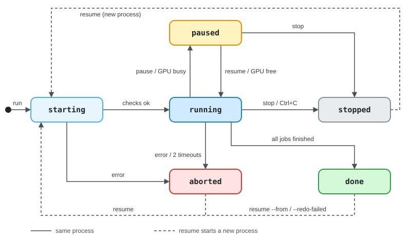

# Architecture

[Magyar](architecture.hu.md)

Last updated: 2026-11-26. **Status: draft** (to be finalized in roadmap step D). The "current" parts describe the
existing code; the "target" and "planned" parts are not implemented yet. Task list: `docs/roadmap.md`.

## 1. Principles

- **CLI parity:** the web UI and any other graphical interface cannot do more than the CLI. New features appear in the
  core and CLI first.
- **Thin interfaces:** measurement, state handling, evaluation and computation (e.g. Pareto front, scores) live in the core.
- **Few dependencies:** the core uses only the Python standard library; external packages are allowed for interfaces,
  exports and the TypeScript harness (official LM Studio SDK).
- **Safe runs:** every external step has a timeout; no automatic retries; pause when the GPU is busy; only the model
  loaded by the run is unloaded; LM Studio config files are restored.
- **Local:** the web server listens on `127.0.0.1` only.
- **Bilingual (planned):** English is primary, Hungarian is a full second language. UI texts come from language files
  (no hard-coded strings) and the language is switchable. Code, comments, identifiers and data field names are English
  and are not translated.

## 2. Current structure

| File | Role |
|---|---|
| `bench.cmd` | Short command for the sweep runner |
| `runner/sweep.py` | CLI, runner, status and control handling, report (single file) |
| `runner/smoke.py` | Smoke test and shared helpers (commands, HTTP, streamed measurement, VRAM sampling) |
| `runner/evaluate.py` | Evaluation of sweep results: estimated response time, warnings, recommendations |
| `runner/config_store.py` | Backup, temporary write and restore of per-model config files |
| `runner/probe_*.py` | One-off discovery scripts (REST keys, KV quantization) |
| `configs/*.json` | Measurement grids: model list, defaults, configurations |
| `tools/export_docs.py` | PDF export of the Markdown files in `docs` (English and Hungarian) |
| `tests/` | Offline tests and one live control test that uses the GPU |

## 3. Target structure (planned)

```
bench/
  core/   environment, LM Studio client, config store, planner, runner, result store, evaluation
  cli/    commands; every feature is reachable here
  api/    FastAPI, a thin wrapper around the core
harness/  TypeScript: agent tool loop, sandbox, tools, trace log
web/      React + Vite + TypeScript, Mantine, ECharts
```

The agent harness runs tasks against a loaded model and writes a trace; failure analysis in the core turns traces into
categories and reports. Its interface to the core (process boundary and trace format) is to be defined before roadmap
step G. Requirements: roadmap section 7.

```
core  ->  CLI
core  ->  FastAPI  ->  React
core  ->  NiceGUI (low priority)
```

## 4. File-based interfaces (current)

The runner and the control commands are separate processes that communicate through files.

| File | Content |
|---|---|
| `state/status.json` | `run`, `state`, `phase`, `phase_since`, `reason`, `total`, `started`, `job_started`, `current` (`n`, `model`, `config`), `heartbeat`, `pid` |
| `state/control.json` | `cmd` (`run` / `pause` / `stop`), `now`, `ts` |
| `state/latest.txt` | Id of the latest run |
| `state/runs/<run>/plan.json` | `grid`, `jobs` (`n`, `id`, `model`, `config`, `settings`), `options`, `env` (runtime, driver) |
| `results/sweep_<run>.jsonl` | One job result per line; the last line wins for a given `job_id` |
| `report/sweep_<run>.md` | Table report |
| `backups/active.json` | Journal of config files not yet restored |

Fields of a successful result row: `job_id`, `run`, `model`, `config`, `settings`, `model_path`, `runtime`, `driver`,
`status`, `load_s`, `echo`, `loaded_quant`, `loaded_publisher`, `vram_before_mib`, `vram_delta_mib`, `runs`, `ttft_s`,
`decode_tok_s`, `prompt_tok_s`, `vram_peak_mib`, `near_vram_limit`, `job_s`, `finished`. A failed row has `error`, and
measurement fields may be missing. `status` is `ok`, `fail`, `timeout` or `invalidated`.

## 5. Run states (current)



| State | Meaning | Next |
|---|---|---|
| `starting` | Preparation | `running`, `aborted` |
| `running` | Measuring | `paused`, `stopped`, `done`, `aborted` |
| `paused` | Model unloaded, configs restored | `running`, `stopped` |
| `stopped` | Stopped by the user | `resume` starts a new process |
| `done` | All jobs finished | `resume --from` / `--redo-failed` starts a new process |
| `aborted` | Error or two consecutive timeouts | `resume` starts a new process |

The runner counts as alive if its `heartbeat` is younger than 20 seconds. Only one run can be active. If the process
dies without reaching an end state (killed, reboot), the stale heartbeat shows it and `resume` starts a new process,
which first restores any config files left modified. The graph is generated by `tools/make_diagrams.py`.

## 6. Commands and planned API

The API routes are proposals and not implemented.

| CLI (current) | API (planned) |
|---|---|
| `bench run --dry-run` | `POST /plans` |
| `bench run` | `POST /runs` |
| `bench status`, `status --jobs` | `GET /runs/current`, `GET /runs/{id}/jobs` |
| `bench pause [--now]` | `POST /runs/current/pause` |
| `bench resume [--from N] [--redo-failed]` | `POST /runs/{id}/resume` |
| `bench stop [--now]` | `POST /runs/current/stop` |
| `bench evaluate [--run] [--in-tokens] [--out-tokens]` | `GET /runs/{id}/evaluation` |

## 7. External dependencies

| Dependency | Used for |
|---|---|
| `lms.exe` | model list, runtime list, starting and stopping the server, unloading models |
| REST `POST /api/v1/models/load` | loading with explicit parameters |
| REST `GET /api/v0/models/{id}` | checking the loaded model |
| REST `POST /v1/chat/completions` | generation and measurement |
| `nvidia-smi` | VRAM, GPU utilization, driver |
| LM Studio per-model config folder (`apps/bionic/...`) | KV quantization, threads, GPU offload; details: `docs/lmstudio_load_parameters.md` |

## 8. Planned format changes

- `schema_version` in every plan and result row.
- Hardware fingerprint: GPU name, VRAM, LM Studio version, runtime, driver.
- Test suite results (quality, tool use) next to speed measurements.
- Flag telling whether the dashboard was open during a measurement.
- Model registry with capability tags.

## 9. Open questions

- Whether the official SDK (`@lmstudio/sdk`) works with the installed LM Studio version. If it does, how the Python
  core uses it for loading (through the harness process, or the Python SDK), replacing the config file edits.
- Detecting spill into shared GPU memory.
- Final choice of test layers (pytest, Vitest, Playwright).
- Location and format of the machine-specific config file.
